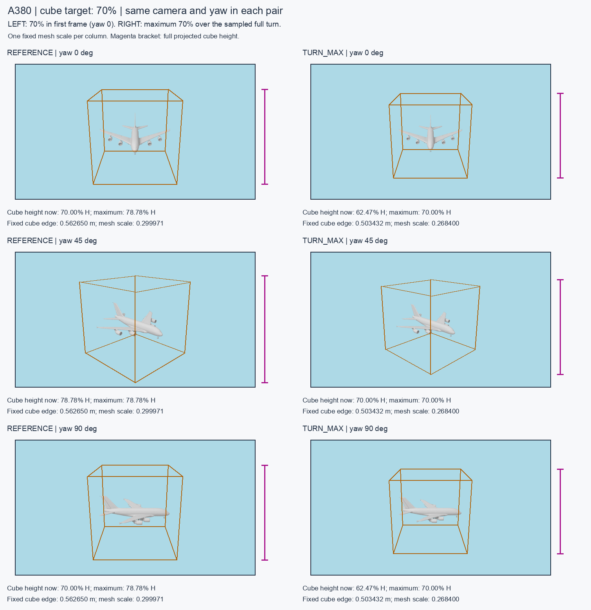

# Cube size: reference view versus turn maximum

Current status: owner accepted `turn_max` placement calculation on 2026-11-07. See [the acceptance record](PLACEMENT_ACCEPTANCE.md); prior preference/review wording below describes the historical comparison. Blender4.2/OptiX integration remains separate.

Owner request, 2026-11-07: prefer maximum-over-turn sizing, but inspect the
same object under both rules before finalizing the policy and progressing to
the next implementation stages. Both modes remain explicit in the commands.



Same A380 source mesh, same camera and lighting in every panel. Target: cube
height 70% of a 960×540 frame. Left calibrates yaw 0; right calibrates the
largest height over yaw 0–359° at 1° increments. The right-hand mesh/cube are
smaller at every corresponding view because a single scale must satisfy the
target at the largest projection. Neither column resizes between frames.

| Quantity | Reference frame | Sampled turn maximum |
| --- | ---: | ---: |
| Cube edge | 0.562649782 m | 0.503431622 m |
| Height at yaw 0° | 70.00% | 62.47% |
| Height at yaw 45° | 78.78% | 70.00% |
| Height at yaw 90° | 70.00% | 62.47% |
| Maximum over all sampled angles | 78.78% | 70.00% |

Thus `turn_max` interprets the percentage as the largest envelope height seen
over the sampled turn. Other frames can be smaller. A height constraint alone
does not promise equal margins or full frame containment. The measured target
is the cube envelope; mesh silhouette height is a separate reported quantity.

## Reproduce from this repository

Supply the external source OBJ (SHA-256 below); raw meshes are not bundled:

```bash
blender -b --factory-startup --python examples/render_cube_sizing_comparison.py -- \
  --mesh /path/to/A380.obj --out /tmp/cube_rule_compare_NEW --target 70

python3 examples/assemble_cube_sizing_comparison.py --out /tmp/cube_rule_compare_NEW
```

The render example applies the original SAL3D static +90° X orientation and
compares both modes at yaw 0/45/90. Blender 4.1.1/Cycles CPU, 12 samples and
diagnostic lighting were used. The assembly script needs Pillow and defaults
to the macOS Arial path; other systems should pass `--font /path/to/font.ttf`.
The [saved full comparison record](evidence/envelope_calibration/cube_rule_comparison.json)
contains source SHA-256, all 360 envelope measurements per rule, transforms,
frame hashes and render settings. Its source mesh SHA-256 is
`046397d6ada42f8438d776ca43bc92c21782681ec406f52d8c329164aaa6fd36`.

This is a local diagnostic comparison for review, not Blender 4.2/OptiX video
acceptance. Later standalone production promotion and target-engine work are
deferred until the owner has reviewed this comparison.
